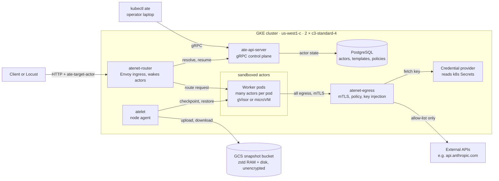
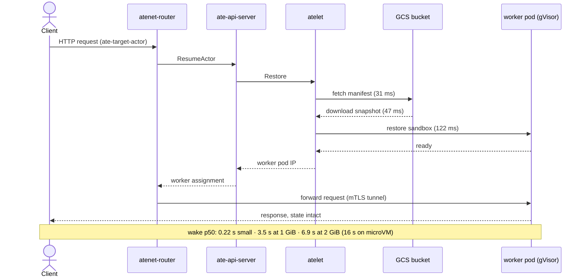
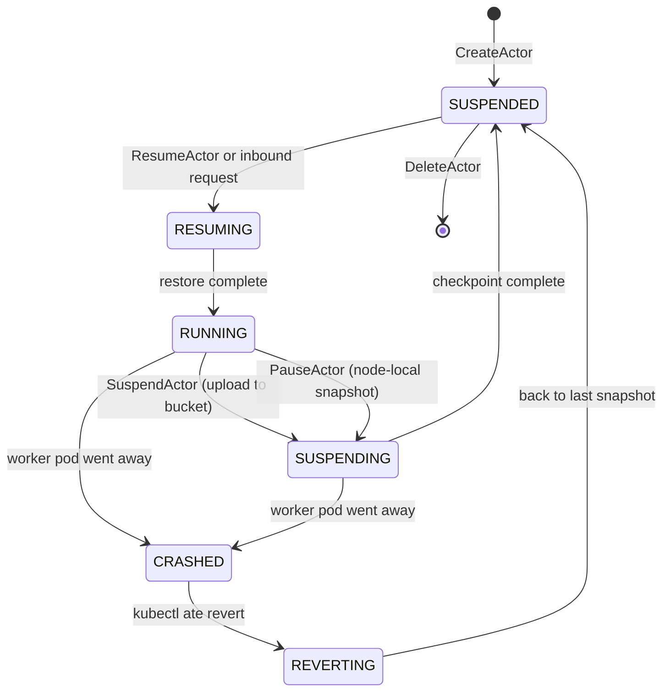
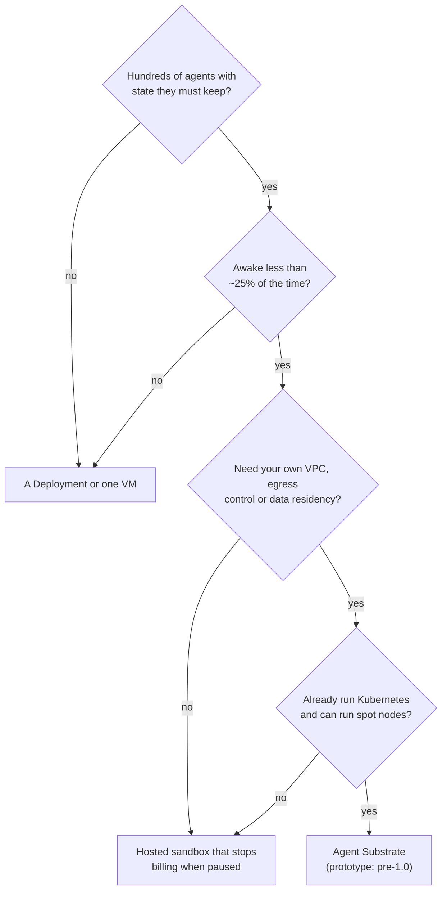
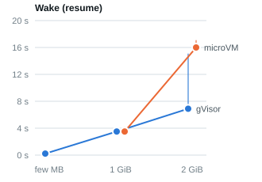
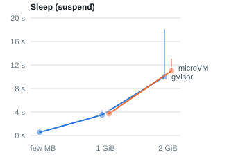
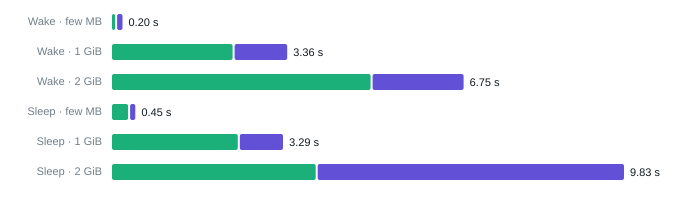
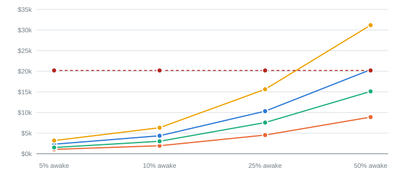

# Agent Substrate — a field test

An independent, reproducible test of [agent-substrate/substrate](https://github.com/agent-substrate/substrate),
the open-source Kubernetes runtime for running large numbers of suspendable agent sandboxes.

We stood it up from zero on GKE, ran real Claude Code agents on it, checked its security claims,
benchmarked it with its own harness, and wrote down what it cost and how long everything took —
including the parts that broke.

**Tested:** upstream `main` @ [`603e006`](https://github.com/agent-substrate/substrate/commit/603e006236f576d9435f46757e3fe2e556768ddf)
(2026-10-16, two days after v0.5.0) · GKE 1.36.4 · 2× `c3-standard-4` · gVisor · `us-west1`.

## Results at a glance

| Agent memory | Wake p50 / p95 (gVisor) | Wake p50 (microVM) | Sleep p50 |
|---|---|---|---|
| a few MB | 0.22 / 0.33 s | — | 0.54 s |
| 1 GiB | 3.5 / 4.0 s | 3.5 s | 3.5 s |
| 2 GiB | 6.9 / 15 s | 16 s | 10 s |

In-cluster, upstream's own Locust harness; 15 agents on 10 workers ran 2,123 requests with zero
failures. Full tables and phase breakdown in [benchmarks.md](docs/benchmarks.md); a visual
report is in [report/index.html](report/index.html).

| Question | Answer | Evidence |
|---|---|---|
| Does state survive suspend/resume? | **Yes.** 20/20 cycles exact (RAM, files, rootfs), across 3 workers | [F1](docs/findings.md#f1--f2--state-persistence-and-migration) |
| Can a real coding agent be frozen and thawed? | **Yes.** 3 Claude Code agents resumed mid-loop, sometimes on another node, and kept working | [F3](docs/findings.md#f3--claude-code-agents) |
| Can agents use API keys without holding them? | **Yes.** Egress gateway injects them; the key was nowhere in the sandbox | [F5](docs/findings.md#f5--egress-credential-injection-and-policy) |
| Is anything the agent *does* hold safe at rest? | **No.** Memory snapshots are unencrypted; we found the API key in them 77 times | [F6](docs/findings.md#f6--secrets-in-memory-snapshots) |
| Is "sub-500 ms resume" true? | **For small agents.** 1 GiB takes ~3.5 s, 2 GiB ~7 s (16 s on microVM) | [benchmarks](docs/benchmarks.md#b2--memory-size-is-the-dominant-factor) |
| What does the test cost? | **~$3** for the day; $12.73/day if left running | [cost.md](docs/cost.md) |
| Is it cheaper than one pod per agent? | **~9× at 5% awake, 2× at 25%, no saving at 50%** (1,000 agents) | [cost.md](docs/cost.md#model-1000-agents-05-vcpu--1-gib-each-when-awake) |
| Is it cheaper than a hosted sandbox? | **Not on on-demand nodes.** E2B/Daytona (not billed while paused) cost less at every duty cycle; Substrate wins only on spot nodes | [cost.md](docs/cost.md#against-hosted-sandboxes) |
| How long to stand up? | ~45–60 min from nothing on an arm64 Mac, of which ~30 is image builds | [timeline](docs/timeline.md) |

## Diagrams

### What we ran

Drawn with [Archify](https://github.com/tt-a1i/archify) from [`report/diagrams/cluster.architecture.json`](report/diagrams/cluster.architecture.json).

<picture>
  <source media="(prefers-color-scheme: dark)" srcset="report/diagrams/arch-dark.svg">
  
</picture>

The same system as Mermaid, for editing:



### How a sleeping agent wakes up

Upstream's resume flow ([`docs/architecture.md`](https://github.com/agent-substrate/substrate/blob/603e006236f576d9435f46757e3fe2e556768ddf/docs/architecture.md)),
annotated with the server-side phase times we measured for a small agent (gVisor, median).



### Actor states

Upstream's state machine plus the crash path, which we hit when a worker pod was deleted under
three running actors.



### How the field test ran

<picture>
  <source media="(prefers-color-scheme: dark)" srcset="report/diagrams/flow-dark.svg">
  
</picture>

The real day, from the timestamps in [`docs/timeline.md`](docs/timeline.md) (IST):

```mermaid
gantt
  title Field test, 16 Oct 2026 (IST)
  dateFormat HH:mm
  axisFormat %H:%M
  section Provision
    Login, project, budget          :done, 11:22, 15m
    setup-gcp bootstrap (GKE)       :done, 11:37, 6m
  section Install
    Install attempt 1 (failed)      :crit, 11:45, 15m
    Install attempt 2 (failed)      :crit, 12:03, 2m
    Install attempt 3               :done, 12:06, 16m
  section Test
    F1 state persistence            :done, 12:26, 5m
    Demos deploy                    :done, 12:31, 9m
    F5 credential injection         :done, 12:35, 11m
    F3 Claude Code agents           :done, 12:46, 22m
    F6 snapshot secret scan         :done, 13:08, 6m
  section Benchmark
    Locust image build              :done, 13:13, 13m
    gVisor suite                    :done, 13:32, 45m
    microVM assets (3 tries)        :crit, 14:16, 31m
    microVM 1-min runs              :done, 14:45, 13m
    5-minute memory runs            :done, 15:00, 37m
```



### Should you run it?



## Charts

From the in-cluster benchmarks; all numbers are in [`results/benchmarks.csv`](results/benchmarks.csv).

**Wake and sleep time by agent memory** (blue gVisor, orange microVM; dot median, whisker p95)

<picture>
  <source media="(prefers-color-scheme: dark)" srcset="report/charts/wake-sleep-by-memory-wake-dark.svg">
  
</picture>
<picture>
  <source media="(prefers-color-scheme: dark)" srcset="report/charts/wake-sleep-by-memory-sleep-dark.svg">
  
</picture>

**Where the time goes** (green: transfer to or from the bucket; purple: sandbox checkpoint or restore)

<picture>
  <source media="(prefers-color-scheme: dark)" srcset="report/charts/phase-breakdown-dark.svg">
  
</picture>

**1,000 agents a month** (blue Substrate on-demand, orange Substrate spot, green E2B or Daytona,
yellow Vercel Sandbox, dashed red one always-on pod per agent)

<picture>
  <source media="(prefers-color-scheme: dark)" srcset="report/charts/cost-1000-agents-dark.svg">
  
</picture>

The full interactive report (tabs, tooltips, tables) is `report/index.html`; open it locally,
since GitHub shows HTML as source.

## Reproduce it

You need: a GCP billing account, `gcloud`, `kubectl`, `go` ≥ 1.25, `docker`, `python3` with
`pyyaml` and `zstandard`, and `zstd` if you want the microVM runs. Budget about **$0.53/hour**
while the cluster is up. Running setup from a cloud VM in the same region instead of a laptop
avoids most of the build and download time.

```bash
cp scripts/env.example.sh scripts/env.sh   # set PROJECT_ID, BILLING_ACCOUNT
scripts/setup.sh                           # ~45-60 min: project, GKE, substrate, demos, bench harness

export CONTEXT=$(kubectl config current-context)
kubectl --context $CONTEXT -n ate-system port-forward svc/atenet-router 8000:80 &

tests/01-state-persistence.sh              # F1/F2  ~5 min
tests/05-credential-injection.sh           # F5     ~2 min
tests/03-claude-multiplex.sh               # F3     ~6 min, needs the Claude demo + an API key
SCAN_SECRET=$ANTHROPIC_API_KEY tests/06-snapshot-secret-scan.py gs://<bucket>/claude-multiplex-demo/

SUBSTRATE=.upstream/substrate CONTEXT=$CONTEXT BUCKET=<bucket> \
  IMAGE=gcr.io/<project>/ate-images/locust-test:latest bench/run-all.sh   # ~1-1.5 h
bench/summarize.py                         # -> results/benchmarks.{csv,md}
python3 report/build_report.py             # -> report/index.html
scripts/sanitize.py --replace <your-project>=<PROJECT_ID>   # strip your identifiers from logs
scripts/verify.sh --forbid <your-project>  # tests, data lineage, links, identifiers: all must pass

scripts/teardown.sh --delete-project       # removes everything; verifies nothing billable remains
```

## Layout

| Path | What |
|---|---|
| [docs/methodology.md](docs/methodology.md) | The question, the tests, pass bars (written before any test ran) |
| [docs/findings.md](docs/findings.md) | What held, what didn't, with evidence |
| [docs/benchmarks.md](docs/benchmarks.md) | Latency, phase breakdown, memory scaling, oversubscription |
| [docs/cost.md](docs/cost.md) | What the test cost, and a cost model for idle agents |
| [docs/use-cases.md](docs/use-cases.md) | Where it fits and where it doesn't |
| [docs/timeline.md](docs/timeline.md) | Every step with wall-clock time, including failures |
| [docs/upstream-issues.md](docs/upstream-issues.md) | Bugs and doc gaps worth reporting upstream |
| [docs/code-review.md](docs/code-review.md) | Independent review of this repo's own scripts, and what was fixed |
| `scripts/` | Setup, verified teardown, `sanitize.py` (strip identifiers), `verify.sh` (publish gate) |
| `report/` | `build_report.py` turns `results/benchmarks.csv` into the visual report |
| `tests/` | Functional tests (bash + python, run from a laptop) |
| `bench/` | Thin wrappers that run upstream's own Locust benchmarks in-cluster |
| `results/` | Raw logs and CSVs from our runs; `benchmarks.csv` is the summary |

## What this is not

- Not a scale test. Two nodes. Upstream's "millions of sandboxes" is their claim, not ours.
- Not a production review: no HA, no upgrades, no multi-day soak, dev-mode auth.
- Not affiliated with the Substrate project or Google.

## License

MIT for everything in this repo ([LICENSE](LICENSE)). Upstream Substrate is Apache-2.0; we
vendor none of it — `scripts/setup.sh` clones it. `docs/upstream-patch-bash32.diff` is a
two-line patch against upstream, offered under upstream's license.
